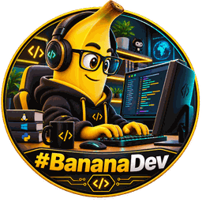

  

<h1 align="center">#BananaDev — Formação autodidata em Análise e Desenvolvimento de Sistemas</h1>

## Matriz curricular 

**Carga horária planejada:** 2.400 horas  
**Estrutura:** 6 semestres de 400 horas  
**Projetos integradores:** 6  
**Versão consolidada:** 20 de novembro de 2026  
**Stack principal:** Python, JavaScript, TypeScript, React, FastAPI, PostgreSQL, Git/GitHub e Docker  
**Idioma:** materiais audiovisuais prioritariamente em português brasileiro (PT-BR).

Percurso independente de estudo, organizado por competências, pré-requisitos, prática e projetos públicos. A carga horária é uma estimativa de dedicação autodidata; não equivale a uma graduação reconhecida nem concede diploma de nível superior.

## Princípios de execução

1. Aprender por entrega: cada etapa termina com um projeto funcional, documentado e versionado.
2. Usar Git e GitHub desde o primeiro semestre: commits, branches, issues, pull requests e revisão de código.
3. Praticar testes, segurança, documentação e acessibilidade ao longo de toda a formação.
4. Usar videoaulas como eixo de aprendizagem sempre que houver playlist adequada; documentação oficial complementa, atualiza e resolve lacunas.
5. Não considerar uma playlist concluída como prova de domínio. O domínio é demonstrado por exercícios, laboratórios e projetos próprios.
6. Manter a stack principal durante o núcleo. Outras linguagens e plataformas ficam para as eletivas e especializações.

**Distribuição estimada das 2.400 horas:** videoaulas e material orientado 20%; documentação e leitura técnica 15%; exercícios e laboratórios 25%; projetos e programação independente 30%; revisão e portfólio 10%.

---

# 1º semestre - Fundamentos de computação e programação

**Carga horária: 400h**  
**Objetivo:** desenvolver raciocínio computacional, aprender Python, compreender os fundamentos do computador e estabelecer um fluxo profissional de versionamento.

### 1. Lógica de Programação e Algoritmos - 50h
**Conteúdo:** pensamento computacional, abstração, algoritmos, pseudocódigo, fluxogramas, variáveis, operadores, condicionais, laços, funções e resolução de problemas.  
**Materiais:** [Curso em Vídeo - Algoritmos e Lógica de Programação][logic].

### 2. Programação I - Python Fundamental - 60h
**Conteúdo:** sintaxe, variáveis, tipos, operadores, entrada e saída, condicionais, repetição, strings, listas básicas e exercícios.  
**Materiais:** [Curso em Vídeo - Python 3, Mundo 1][python1].

### 3. Matemática Discreta para Computação - 40h
**Conteúdo:** lógica proposicional, conjuntos, relações, funções, combinatória, indução, grafos e árvores.  
**Materiais:** [IFBA - Matemática Discreta I][discrete].

### 4. Arquitetura e Organização de Computadores - 35h
**Conteúdo:** sistemas binários, CPU, memória, registradores, barramentos, instruções, cache, armazenamento e desempenho.  
**Materiais:** [Curso de Arquitetura de Computadores][architecture].

### 5. Sistemas Operacionais e Linux I - 45h
**Conteúdo:** processos, threads, memória, escalonamento, sistemas de arquivos, permissões, terminal, shell, usuários e serviços.  
**Materiais:** [Sistemas Operacionais - UFG][operating_systems] e [Linux - Curso em Vídeo][linux_intro].

### 6. Redes de Computadores e Internet - 35h
**Conteúdo:** OSI, TCP/IP, IPv4, IPv6, DNS, DHCP, HTTP, HTTPS, TCP, UDP e fundamentos de roteamento.  
**Materiais:** [Curso em Vídeo - Redes de Computadores][networks].

### 7. Git, GitHub e Engenharia de Colaboração I - 40h
**Conteúdo:** controle de versão, repositórios, commit, log, branches, merge, rebase, conflitos, push, pull, fork, pull requests, issues, README e Conventional Commits.  
**Materiais:** [Git e GitHub - Curso em Vídeo][git_video], [Git, GitHub e Metodologia Ágil - Programador Lhama][git_lhama], [Pro Git em português][progit] e [Documentação GitHub em português][github_docs].

### 8. Comunicação Técnica e Inglês para Desenvolvedores I - 20h
**Conteúdo:** comunicação escrita, documentação, leitura técnica, vocabulário, commits e apresentações.  
**Materiais:** [Comunicação Escrita no Trabalho][writing] e [Inglês para Devs - Rocketseat][english_devs].

### Projeto Integrador I - Sistema de Console - 75h
**Entrega:** sistema de cadastro, gerenciamento ou automação em Python, executado no terminal Linux, com funções, módulos, validação, manipulação de arquivos, tratamento de exceções, README e histórico Git. Integrar uma funcionalidade por pull request.

---

# 2º semestre - Python intermediário, estruturas de dados e banco de dados

**Carga horária: 400h**  
**Objetivo:** consolidar programação, orientação a objetos, algoritmos, Linux aplicado ao desenvolvimento, SQL e qualidade de código.

### 9. Programação II - Python Intermediário e POO - 55h
**Conteúdo:** estruturas compostas, funções, módulos, escopo, arquivos, exceções, classes, objetos, atributos, métodos, herança e polimorfismo.  
**Materiais:** [Python Mundo 2][python2], [Python Mundo 3][python3] e [Python POO - Curso em Vídeo][python_poo]. A playlist de POO foi corrigida para o endereço específico de Python orientado a objetos.

### 10. Estruturas de Dados e Análise de Algoritmos - 65h
**Conteúdo:** Big O, complexidade, recursividade, busca, ordenação, listas encadeadas, pilhas, filas, árvores, tabelas hash e grafos. Implementação em Python.  
**Materiais:** [USP - Algoritmos e Estruturas de Dados I][data_structures_usp] e [UNIVESP - Estruturas de Dados][data_structures_univesp].

### 11. Banco de Dados I - Modelagem Relacional e SQL - 60h
**Conteúdo:** SGBDs, modelo entidade-relacionamento, modelagem conceitual e lógica, normalização, chaves, relacionamentos, tabelas, DDL, DML e consultas.  
**Materiais:** [Bóson - Curso de PostgreSQL][postgres_boson] e [Modelo Entidade-Relacionamento (MER)][mer].

### 12. Linux para Desenvolvimento e Shell Scripting - 40h
**Conteúdo:** Bash, shell script, variáveis de ambiente, permissões, processos, logs, SSH, comandos administrativos, pipes, redirecionamento e serviços.  
**Materiais:** [Bóson - Linux Básico / LPIC-1][lpic1] e [Manual GNU Bash][bash_manual].

### 13. Engenharia de Software I - Processos e Métodos - 40h
**Conteúdo:** ciclo de vida, modelos de desenvolvimento, processos, requisitos introdutórios, métodos ágeis, Scrum, Kanban, documentação e qualidade.  
**Materiais:** [UNIVESP - Engenharia de Software][software_engineering_univesp].

### 14. Testes de Software I - Fundamentos e TDD - 40h
**Conteúdo:** testes unitários, integração, sistema, aceitação, caixa-preta, caixa-branca, regressão, pirâmide de testes, TDD introdutório e pytest.  
**Materiais:** [CTFL - Fundamentos de Teste][ctfl], [Pytest em Python - playlist][pytest_video] e [documentação pytest][pytest_docs].

### 15. Probabilidade e Estatística para Computação - 35h
**Conteúdo:** probabilidade, estatística descritiva, distribuições, média, variância, amostragem, correlação e interpretação de dados.  
**Materiais:** [UNIVESP - Estatística][statistics].

### Projeto Integrador II - Sistema de Gerenciamento de Dados - 65h
**Entrega:** sistema de estoque, biblioteca ou gerenciamento financeiro com POO, estruturas de dados implementadas, PostgreSQL, modelo entidade-relacionamento, SQL, testes com pytest, scripts de instalação, issues e pull requests.

---

# 3º semestre - Desenvolvimento Web, requisitos, SQL avançado e APIs

**Carga horária: 400h**  
**Objetivo:** construir a base de desenvolvimento Web, especificar sistemas, projetar contratos de APIs e aprofundar banco de dados.

### 16. Desenvolvimento Web I - HTML5 e CSS3 - 55h
**Conteúdo:** HTML semântico, formulários, acessibilidade, estrutura documental, CSS, seletores, cascata, box model, Flexbox, Grid, media queries e responsividade.  
**Materiais:** [Módulo 1][html1], [Módulo 2][html2], [Módulo 3][html3], [Módulo 4][html4] e [Módulo 5][html5] do Curso em Vídeo.

### 17. Desenvolvimento Web II - JavaScript Moderno - 65h
**Conteúdo:** ECMAScript, tipos, variáveis, escopos, funções, arrays, objetos, DOM, eventos, módulos, promises, async/await, Fetch API e JSON.  
**Materiais:** [Curso em Vídeo - JavaScript e ECMAScript][javascript] e [MDN - JavaScript][mdn_javascript].

### 18. Desenvolvimento Web III - TypeScript - 35h
**Conteúdo:** tipagem estática, inferência, interfaces, classes, generics, union types, funções, módulos, tipos avançados e integração com JavaScript.  
**Materiais:** [Glaucia Lemos - TypeScript Zero to Hero][typescript].

### 19. Engenharia de Requisitos, UML e BPMN - 45h
**Conteúdo:** requisitos funcionais e não funcionais, histórias de usuário, casos de uso, critérios de aceitação, backlog, diagramas UML, modelagem de domínio e processos BPMN.  
**Materiais:** [Análise e Projeto de Sistemas - Rodrigo Campos][requirements] e [BPMN usando Bizagi][bpmn].

### 20. Banco de Dados II - SQL Avançado e PostgreSQL - 50h
**Conteúdo:** joins, subconsultas, agregações, CTEs, índices, views, procedures, triggers, transações, concorrência, integridade e otimização de consultas.  
**Materiais:** [Guia Completo PostgreSQL - Professor Marco Maddo][postgres_advanced] como apoio audiovisual; [documentação PostgreSQL em PT-BR, versão 18.1][postgres_ptbr] para consulta; [documentação oficial da versão atual][postgres_current] como referência complementar em inglês.

### 21. APIs REST, HTTP e Documentação OpenAPI - 50h
**Conteúdo:** cliente-servidor, métodos HTTP, status codes, REST, JSON, CRUD, versionamento, autenticação conceitual, contratos, Swagger, OpenAPI, Postman e Insomnia.  
**Materiais:** [Curso de POSTMAN, APIs & HTTP Completo][postman_full] como trilha principal e [Curso de Postman][postman_course] como complemento; [Postman Learning Hub][postman_learning], [especificação OpenAPI 3.2.1][openapi] e [MDN - HTTP][mdn_http] como referências. Praticar collections, environments, variáveis, autenticação, requisições, scripts e testes de resposta. As duas playlists são diferentes; quando repetirem uma introdução, não refazer a mesma atividade.

### 22. Interação Humano-Computador, UX/UI e Acessibilidade - 35h
**Conteúdo:** usabilidade, ergonomia, heurísticas, prototipagem, arquitetura de informação, pesquisa de usuários, acessibilidade, testes e design responsivo.  
**Materiais:** [Disciplina IHC - Thiago Jabur][ihc] e [Figma - Chief of Design][figma].

### 23. Testes Automatizados II - Web e APIs - 25h
**Conteúdo:** estratégias de teste de interfaces, integração Web, cenários, automação, assertions, testes de endpoints e cobertura.  
**Materiais:** [curso completo de testes com Vitest, React Testing Library e Playwright (11h)][tests_vitest_playwright] como complemento audiovisual (o exemplo usa Next.js); [documentação Playwright][playwright] e [documentação pytest][pytest_docs]. Adaptar os padrões de teste ao front-end React e às APIs do projeto.

### Projeto Integrador III - Aplicação Web e Contrato de API - 40h
**Entrega:** aplicação Web responsiva e acessível com HTML/CSS, JavaScript, TypeScript introdutório, protótipo Figma, requisitos, PostgreSQL, contrato OpenAPI, collection Postman e testes dos fluxos principais.

---

# 4º semestre - Full Stack, back-end Python, testes, segurança e Docker

**Carga horária: 400h**  
**Objetivo:** desenvolver uma aplicação completa, segura, testável e containerizada.

### 24. Front-end Avançado - React e TypeScript - 55h
**Conteúdo:** JSX, componentes, props, estado, hooks, contexto, roteamento, formulários, consumo de APIs, tratamento de erros e gerenciamento de estado.  
**Materiais:** [Curso de React com TypeScript][react_typescript] e [documentação React em português][react_docs].

### 25. Back-end I - Python e FastAPI - 60h
**Conteúdo:** endpoints, rotas, CRUD, schemas Pydantic, dependências, organização de projetos, tratamento de erros e APIs REST.  
**Materiais:** [FastAPI do Zero - curso aberto][fastapi_book] e [aulas síncronas de 2025][fastapi_2025]. As aulas cobrem CRUD, PostgreSQL, autenticação, async, Docker, testes/CI e deploy.

### 26. Persistência, Autenticação e Integração de APIs - 45h
**Conteúdo:** PostgreSQL, SQLAlchemy, Alembic, migrations, relacionamentos, autenticação, autorização, hashing, JWT, operações assíncronas e documentação automática.  
**Materiais:** [SQLAlchemy Survivor Guide][sqlalchemy_video], [Assincronismo em Python e FastAPI][async_fastapi_video] e continuação do [FastAPI do Zero][fastapi_book].

### 27. Testes Automatizados III - Back-end e Integração - 45h
**Conteúdo:** pytest, fixtures, mocks, testes unitários, integração, cobertura, testes de autenticação, endpoints, TDD e pipelines de testes.  
**Materiais:** [playlist Testes Unitários em Python][pytest_video], módulos de testes e CI do [FastAPI do Zero][fastapi_book] e [documentação pytest][pytest_docs].

### 28. Segurança de Aplicações Web - OWASP - 45h
**Conteúdo:** controle de acesso, injeções, XSS, CSRF, autenticação, autorização, hashing, criptografia, configuração segura, dependências e gestão de segredos.  
**Materiais:** [OWASP Top 10:2025 - Português Brasileiro][owasp] e laboratório de identificação e correção de vulnerabilidades no próprio projeto.

### 29. Docker e Contêineres - 45h
**Conteúdo:** imagens, containers, Dockerfile, build, volumes, redes, Docker Compose, variáveis de ambiente, containers para aplicações Web e persistência.  
**Materiais:** [LinuxTips - Descomplicando Docker][docker_linuxtips], [Docker na Prática com Python - Programador Lhama][docker_python] e [livro aberto Descomplicando Docker][docker_book].

### 30. Clean Code, SOLID e Padrões de Projeto - 45h
**Conteúdo:** código limpo, coesão, acoplamento, responsabilidades, SOLID, MVC, Strategy, Factory, Observer, Dependency Injection e refatoração.  
**Materiais:** [Design Patterns GoF - Otávio Miranda][design_patterns], [Clean Architecture em Python - Programador Lhama][clean_architecture] e [Refactoring Guru - Padrões de Projeto][refactoring].

### Projeto Integrador IV - Aplicação Full Stack - 60h
**Entrega:** sistema React/TypeScript + FastAPI + PostgreSQL com autenticação e autorização, CRUD completo, OpenAPI, testes automatizados, Dockerfile, Docker Compose, README e execução local reproduzível. Outra pessoa deve conseguir clonar, configurar e executar o sistema seguindo o README.

---

# 5º semestre - Cloud, DevOps, arquitetura moderna e observabilidade

**Carga horária: 400h**  
**Objetivo:** preparar, implantar, monitorar e manter sistemas fora do ambiente de desenvolvimento.

### 31. Computação em Nuvem e Infraestrutura - 55h
**Conteúdo:** IaaS, PaaS, SaaS, virtualização, máquinas virtuais, redes, armazenamento, disponibilidade, escalabilidade, serviços gerenciados e ambientes de cloud.  
**Materiais:** [Curso AWS na Prática][aws_practice] e [AWS Skill Builder][aws_skillbuilder].

### 32. Linux para Servidores e Administração de Ambientes - 35h
**Conteúdo:** SSH, usuários, permissões, serviços, systemd, logs, firewall, processos, variáveis de ambiente, administração e preparação de servidor.  
**Materiais:** continuação direcionada do [Bóson - Linux Básico / LPIC-1][lpic1] e laboratórios com servidor Linux próprio.

### 33. CI/CD e Automação de Entrega - 40h
**Conteúdo:** GitHub Actions, workflows, eventos, jobs, runners, execução automatizada de testes, build, deploy, ambientes e gestão de secrets.  
**Materiais:** [EV.G/Microsoft/Enap - GitHub Actions][evg_actions] (curso aberto, 4h, em português) e [documentação GitHub Actions em português][actions_docs].

### 34. Arquitetura de Software Avançada e Sistemas Distribuídos - 60h
**Conteúdo:** Clean Architecture, arquitetura hexagonal, monólito modular, microsserviços, comunicação síncrona e assíncrona, tolerância a falhas, escalabilidade, consistência e sincronização.  
**Materiais:** [UNIVESP - Sistemas Distribuídos][distributed_systems], [IFBA - Engenharia de Software][ifba_software] e [Clean Architecture em Python][clean_architecture]. Dominar primeiro um monólito modular; microsserviços são estudados conceitualmente e em laboratório controlado.

### 35. Banco de Dados IV - NoSQL e Cache - 40h
**Conteúdo:** MongoDB, documentos, coleções, consultas, agregações, índices, modelagem documental, replicação, consistência e introdução a Redis.  
**Materiais:** [Curso de MongoDB para Iniciantes][mongodb_video], [MongoDB em Python - Programador Lhama][mongodb_python] e [documentação MongoDB em português][mongodb_docs]; [Arquitetura em Redis com Python][redis_python] para o módulo de cache.

### 36. Observabilidade e Monitoramento de Aplicações - 40h
**Conteúdo:** logs, métricas, tracing, health checks, dashboards, alertas, Prometheus, Grafana, OpenTelemetry e diagnóstico de incidentes.  
**Materiais:** canal [Observabilidade na Prática][observability_channel], [Prometheus - documentação][prometheus_docs] e [Grafana - documentação][grafana_docs]. Completar com laboratório de instrumentação da aplicação, métricas, logs estruturados, traces e alertas.

### 37. FinOps e Gestão de Custos em Nuvem - 25h
**Conteúdo:** custos de infraestrutura, dimensionamento, orçamento, consumo, monitoramento financeiro, recursos ociosos, escalabilidade econômica e estimativas de implantação.  
**Materiais:** [AWS Pricing Calculator][aws_calculator], [AWS Skill Builder][aws_skillbuilder] e [workshop de custos AWS de 2026][aws_finops_video]. Analisar o custo mensal real do Projeto Integrador V.

### 38. Mensageria e Integração Assíncrona - 35h
**Conteúdo:** filas, eventos, produtores, consumidores, confirmação de mensagens, entrega, retentativas, dead-letter queues e conceitos de RabbitMQ/Kafka.  
**Materiais:** [Mensageria em RabbitMQ com Python - Programador Lhama][rabbitmq_python], [tutoriais RabbitMQ][rabbitmq_docs] e [documentação Apache Kafka][kafka_docs].

### Projeto Integrador V - Sistema em Produção - 70h
**Entrega:** aplicação completa containerizada e implantada em cloud, com pipeline GitHub Actions, PostgreSQL e/ou MongoDB, logs, métricas, health checks, backups, documentação operacional, estimativa e controle de custos.

---

# 6º semestre - IA, engenharia de dados, DevSecOps e formação profissional

**Carga horária: 400h**  
**Objetivo:** aprofundar áreas emergentes sem perder a prioridade em engenharia de software e consolidar a formação em um produto open source.

### 39. Álgebra Linear e Matemática Aplicada à IA - 35h
**Conteúdo:** matrizes, vetores, operações matriciais, transformações lineares, sistemas lineares, autovalores, autovetores e aplicações computacionais.  
**Materiais:** [UNIVESP - Álgebra Linear][linear_algebra].

### 40. Inteligência Artificial e Machine Learning com Python - 45h
**Conteúdo:** IA, aprendizado supervisionado e não supervisionado, regressão, classificação, agrupamento, preparação de dados, métricas e avaliação de modelos.  
**Materiais:** [Didática Tech - Python para Machine Learning e Análise de Dados][machine_learning] e [documentação scikit-learn][scikit_learn].

### 41. Engenharia de Dados e Pipelines ETL/ELT - 45h
**Conteúdo:** extração, transformação, limpeza, validação, integração, armazenamento, Pandas, SQL analítico, qualidade de dados, pipelines e fundamentos de Data Warehouse.  
**Materiais:** [Scrapper Python: ETL Pipeline - Programador Lhama][etl_video], [Curso de Análise de Dados com Python, NumPy e Pandas][pandas_playlist] e [documentação Pandas][pandas_docs].

### 42. DevSecOps e Segurança da Cadeia de Software - 35h
**Conteúdo:** segurança de dependências, análise estática e dinâmica, gestão de vulnerabilidades, SAST, DAST, segurança de containers, segredos e pipelines seguros.  
**Materiais:** [OWASP Top 10:2025][owasp] e [GitHub Code Security em português][github_security]. Aplicar análise de dependências, secret scanning e verificações automatizadas nos repositórios.

### 43. Ética, LGPD, Governança e Licenciamento Open Source - 25h
**Conteúdo:** ética profissional, privacidade, proteção de dados pessoais, propriedade intelectual, licenças, direitos autorais, responsabilidade e governança.  
**Materiais:** [Oficinas de LGPD da Secretaria de Governo Digital (listadas pela UFOP)][lgpd_videos] e [Choose a License - português][choose_license].

### 44. Eletiva Tecnológica - 45h
**Conteúdo:** escolha de uma especialização: desenvolvimento mobile, Java/Spring, C#/.NET, PHP/Laravel, Go, GraphQL, Kubernetes ou mensageria avançada.  
**Materiais:** escolha uma única trilha da seção de especializações opcionais e conclua um laboratório próprio.

### 45. Preparação Técnica, Entrevistas e Colaboração Open Source - 25h
**Conteúdo:** resolução de problemas, algoritmos para entrevistas, análise de complexidade, revisão de código, contribuição externa, comunicação profissional e apresentação técnica.  
**Materiais:** [LeetCode - Problemset][leetcode], [HackerRank - Algorithms][hackerrank] e [GitHub - Contribuir para projetos open source][github_contribute].

### Projeto Integrador VI - Produto Open Source e Portfólio - 145h
**Entrega:** produto open source funcional, com arquitetura documentada, banco de dados, APIs documentadas, testes automatizados, segurança aplicada, Docker, CI/CD, deploy, monitoramento, README em português e inglês, licença, issues, milestones, pull requests e pelo menos uma contribuição real em repositório de terceiros.

---

# Especializações opcionais - após o núcleo principal

Escolher uma especialização por vez. Essas tecnologias não são pré-requisitos para concluir a stack principal Python/FastAPI/React.

- **Java e Spring Boot:** Java, POO, Collections, Spring, JPA, Hibernate e APIs. [DevDojo - Maratona Java][java] e [Michelli Brito - Spring Boot][spring].
- **PHP e Laravel:** PHP moderno, POO, Composer, MVC, Laravel, Eloquent e APIs. [Curso em Vídeo - PHP Moderno][php] e [Curso Laravel][laravel].
- **C# e .NET:** C#, POO, LINQ, ASP.NET Core, Entity Framework e APIs. [Microsoft Learn - C# em português][csharp].
- **Node.js e Express:** Node.js, NPM, Express, TypeScript, APIs e integração. [API Node.js com TypeScript][node_typescript].
- **Desenvolvimento Mobile:** Dart, Flutter, widgets, navegação, APIs e armazenamento. [Curso Flutter e Dart][flutter].
- **GraphQL:** schemas, queries, mutations, resolvers, autenticação e integração. [GraphQL - Learn][graphql].
- **Kubernetes:** pods, deployments, services, volumes, Helm e orquestração. [Documentação Kubernetes em português][kubernetes].
- **Go:** sintaxe, tipos, funções, interfaces, concorrência e APIs. [Go - materiais de aprendizagem][go].
- **C e C++:** memória, ponteiros, estruturas de dados, compilação e desempenho. [Learn C++][cpp].

---

# Seis projetos integradores

### PI I - Sistema de Console em Python (1º semestre)
Sistema de cadastro, gestão ou automação com funções, arquivos, exceções, testes iniciais e Git; execução documentada pelo terminal.

### PI II - Sistema de Gestão de Dados (2º semestre)
Aplicação Python com POO, algoritmos, PostgreSQL, persistência relacional, modelagem e testes.

### PI III - Aplicação Web (3º semestre)
Site funcional, responsivo e acessível, com protótipo, requisitos, JavaScript, TypeScript e contrato de API.

### PI IV - Aplicação Full Stack (4º semestre)
React, TypeScript, FastAPI, PostgreSQL, autenticação, testes e Docker; execução reproduzível.

### PI V - Sistema em Produção (5º semestre)
Aplicação implantada na nuvem, com CI/CD, monitoramento, logs, backups e controle de custos.

### PI VI - Produto Open Source Final (6º semestre)
Produto público completo, com arquitetura, qualidade, segurança, contribuição comunitária, releases e portfólio.

# Regras de desenvolvimento Open Source

Todos os projetos devem seguir o mesmo fluxo de trabalho:

- Um repositório separado para cada projeto.
- README em português; inglês nos projetos mais maduros.
- Issues para tarefas, bugs e melhorias.
- Milestones para organizar entregas.
- Branches por funcionalidade ou correção.
- Pull Requests para integrar mudanças.
- Conventional Commits.
- Revisão de código, testes e verificações automatizadas.
- GitHub Actions para CI/CD quando aplicável.
- Releases para versões estáveis.
- Licença adequada para cada repositório.

**Fluxo:** identificar tarefa → criar branch → implementar → executar testes → abrir pull request → revisar → integrar → atualizar documentação → publicar release.

# Critérios para avançar de etapa

1. **Fundamentos:** resolver problemas, programar em Python e usar Linux/Git.
2. **Programação e dados:** implementar estruturas de dados, programar com POO, modelar bancos e escrever consultas SQL e testes.
3. **Desenvolvimento Web:** construir páginas responsivas, manipular DOM, trabalhar com TypeScript e documentar requisitos e APIs.
4. **Full Stack:** desenvolver aplicações completas, criar APIs, implementar autenticação, testes, segurança e Docker.
5. **Infraestrutura:** implantar aplicações, automatizar pipelines, configurar monitoramento e compreender arquitetura distribuída.
6. **Profissionalização:** construir produto público, demonstrar qualidade, segurança, independência técnica e colaboração open source.

Para concluir cada disciplina: estudar a ementa; resolver exercícios sem copiar diretamente; implementar pelo menos um laboratório próprio; fazer uma avaliação técnica; documentar o aprendizado; publicar as entregas no GitHub; e explicar as decisões adotadas no código.

# Planejamento de dedicação

As 2.400 horas incluem vídeo, leitura, prática, debugging, exercícios, documentação, projetos e revisão - não apenas a duração das playlists.

- **Intensivo:** 30h por semana - 80 semanas, cerca de 18 meses.
- **Moderado:** 20h por semana - 120 semanas, cerca de 28 meses.
- **Flexível:** 10h por semana - 240 semanas, cerca de 55 meses.

São estimativas aritméticas de dedicação, não promessas de domínio profissional ou empregabilidade.

---

<!-- Referências: cada URL aparece uma única vez neste bloco. Os rótulos são reutilizados ao longo da matriz para evitar links duplicados. -->

[logic]: https://www.youtube.com/playlist?list=PLHz_AreHm4dmSj0MHol_aoNYCSGFqvfXV
[python1]: https://www.youtube.com/playlist?list=PLHz_AreHm4dlKP6QQCekuIPky1CiwmdI6
[discrete]: https://www.youtube.com/playlist?list=PL8aWdrmfXHiI8ZIKuyNabmLYrvIY9yhPF
[architecture]: https://www.youtube.com/playlist?list=PL_9px37PNj6q8Ac7y6rbXJFfloBAh7JcT
[operating_systems]: https://www.youtube.com/playlist?list=PLn9tst_548zU9utXG07-6jZ4zb57yJTtO
[linux_intro]: https://www.youtube.com/playlist?list=PLHz_AreHm4dlIXleu20uwPWFOSswqLYbV
[networks]: https://www.youtube.com/playlist?list=PLHz_AreHm4dkd4lr9G0Up-W-YaHYdTDuP
[git_video]: https://www.youtube.com/watch?v=192HgwRgOYE
[git_lhama]: https://www.youtube.com/playlist?list=PLAgbpJQADBGKPIQvIoQbp3SfY3_5bhL3K
[progit]: https://git-scm.com/book/pt-br/v2
[github_docs]: https://docs.github.com/pt
[writing]: https://www.youtube.com/playlist?list=PLlKcSDEuh_BMMwcdCs6AfNh6oeR6SNiEd
[english_devs]: https://www.youtube.com/playlist?list=PL85ITvJ7FLoil5gD1M9BpUB4YSvnYKR16
[python2]: https://www.youtube.com/playlist?list=PLHz_AreHm4dk_nZHmxxf_J0WRAqy5Czye
[python3]: https://www.youtube.com/playlist?list=PLHz_AreHm4dksnH2jVTIVNviIMBVYyFnH
[python_poo]: https://www.youtube.com/playlist?list=PLHz_AreHm4dn_RXXoa3Ameh77f95Hgwv3
[data_structures_usp]: https://www.youtube.com/playlist?list=PL_JAaU8k6DQXxJ_HL_kiy8_jXzGs6e6EH
[data_structures_univesp]: https://www.youtube.com/playlist?list=PLxI8Can9yAHf8k8LrUePyj0y3lLpigGcl
[postgres_boson]: https://www.youtube.com/playlist?list=PLucm8g_ezqNoAkYKXN_zWupyH6hQCAwxY
[mer]: https://youtu.be/IpFn-KsWPW0
[lpic1]: https://www.youtube.com/playlist?list=PLucm8g_ezqNp92MmkF9p_cj4yhT-fCTl7
[bash_manual]: https://www.gnu.org/software/bash/manual/bash.html
[software_engineering_univesp]: https://www.youtube.com/playlist?list=PLxI8Can9yAHfeoA_yMm9iKJVxQprljmL9
[ctfl]: https://www.youtube.com/playlist?list=PLx6gdu4s3nkf4OcLZ--TgMCHr22H7TDCs
[pytest_video]: https://www.youtube.com/playlist?list=PLAgbpJQADBGIicaxuo9hI5EmcK85ck5X2
[pytest_docs]: https://docs.pytest.org/
[tests_vitest_playwright]: https://www.youtube.com/watch?v=u1sg_uD8H4g
[statistics]: https://www.youtube.com/playlist?list=PLxI8Can9yAHdJq561NyRN9wZpTqVJn0Z0
[html1]: https://www.youtube.com/playlist?list=PLHz_AreHm4dkZ9-atkcmcBaMZdmLHft8n
[html2]: https://www.youtube.com/playlist?list=PLHz_AreHm4dlUpEXkY1AyVLQGcpSgVF8s
[html3]: https://www.youtube.com/playlist?list=PLHz_AreHm4dmcAviDwiGgHbeEJToxbOpZ
[html4]: https://www.youtube.com/playlist?list=PLHz_AreHm4dkcVCk2Bn_fdVQ81Fkrh6WT
[html5]: https://www.youtube.com/playlist?list=PLHz_AreHm4dn1bAtIJWFrugl5z2Ej_52d
[javascript]: https://www.youtube.com/playlist?list=PLHz_AreHm4dlsK3Nr9GVvXCbpQyHQl1o1
[mdn_javascript]: https://developer.mozilla.org/pt-BR/docs/Web/JavaScript
[typescript]: https://www.youtube.com/playlist?list=PLb2HQ45KP0Wsk-p_0c6ImqBAEFEY-LU9H
[requirements]: https://www.youtube.com/playlist?list=PLm2YCT58S2dBGDDgJasQV_Yyfnd7Y0Byx
[bpmn]: https://www.youtube.com/playlist?list=PLMkQF4wtzuVMulNB1GJ15sw0BRevwkK9N
[postgres_advanced]: https://www.youtube.com/playlist?list=PLDqAb8tE7SQZzMWvPG4PYevQAW1cDsbD0
[postgres_ptbr]: https://pgdocptbr18-11aacb.gitlab.io/
[postgres_current]: https://www.postgresql.org/docs/current/index.html
[postman_full]: https://www.youtube.com/playlist?list=PL-tb3yiDrcKrtxjtOC0nLVwuD7Qe0kSuR
[postman_course]: https://www.youtube.com/playlist?list=PLnPZ9TE1Tj4BG6Y2Wntb5yCIauEUPoyrW
[postman_learning]: https://www.postman.com/learn/
[openapi]: https://spec.openapis.org/oas/v3.2.1.html
[mdn_http]: https://developer.mozilla.org/pt-BR/docs/Web/HTTP
[ihc]: https://www.youtube.com/playlist?list=PLNNPNNvgZUlq9B9pgoAqxoE3pEbkyUQ0d
[figma]: https://www.youtube.com/playlist?list=PLwgL9IEA0PxXzmOu0crRl9l6PT46nqtI9
[playwright]: https://playwright.dev/docs/intro
[react_typescript]: https://www.youtube.com/playlist?list=PL29TaWXah3iZktD5o1IHbc7JDqG_80iOm
[react_docs]: https://pt-br.react.dev/learn
[fastapi_book]: https://fastapidozero.dunossauro.com/4.3/
[fastapi_2025]: https://www.youtube.com/playlist?list=PLOQgLBuj2-3KT9ZWvPmaGFQ0KjIez0403
[async_fastapi_video]: https://www.youtube.com/playlist?list=PLAgbpJQADBGJserIipQ04-bZjRrqjvJmV
[sqlalchemy_video]: https://www.youtube.com/playlist?list=PLAgbpJQADBGKbwhOvd9DVWy-xhA1KEGm1
[owasp]: https://top10.owasp.org/2025/pt-BR/
[docker_linuxtips]: https://www.youtube.com/playlist?list=PLf-O3X2-mxDn1VpyU2q3fuI6YYeIWp5rR
[docker_python]: https://www.youtube.com/playlist?list=PLAgbpJQADBGIDbMSopaqFnGm7GJnwru0-
[docker_book]: https://github.com/badtuxx/DescomplicandoDocker
[design_patterns]: https://www.youtube.com/playlist?list=PLbIBj8vQhvm0VY5YrMrafWaQY2EnJ3j8H
[clean_architecture]: https://www.youtube.com/playlist?list=PLAgbpJQADBGK0opZ8ZuDX3zDjQck_QKMy
[refactoring]: https://refactoring.guru/pt-br/design-patterns
[aws_practice]: https://www.youtube.com/playlist?list=PLOF5f9_x-OYUaqJar6EKRAonJNSHDFZUm
[aws_skillbuilder]: https://skillbuilder.aws/
[evg_actions]: https://www.escolavirtual.gov.br/cursos/github-actions 
[actions_docs]: https://docs.github.com/pt/actions
[distributed_systems]: https://www.youtube.com/playlist?list=PLxI8Can9yAHdAU8zIvJTKcbhgRyzwjII2
[ifba_software]: https://www.youtube.com/playlist?list=PLcilqwq_HuxVaCJDC5VPLgzZTmv3y9Lpd
[mongodb_video]: https://www.youtube.com/playlist?list=PLxuFqIk29JL0DMM0Z-S9_XEHAexXvhYyb
[mongodb_python]: https://www.youtube.com/playlist?list=PLAgbpJQADBGLk7QlD_rzH9vqbt3TrwL-k
[mongodb_docs]: https://www.mongodb.com/pt-br/docs/
[observability_channel]: https://www.youtube.com/@ObservabilidadenaPr%C3%A1tica
[prometheus_docs]: https://prometheus.io/docs/introduction/overview/
[grafana_docs]: https://grafana.com/docs/grafana/latest/
[aws_calculator]: https://calculator.aws/#/
[aws_finops_video]: https://www.youtube.com/watch?v=qLQ6NHZIQH8
[rabbitmq_python]: https://www.youtube.com/playlist?list=PLAgbpJQADBGLW5Q_OE86RzRb8HDvDzs-m
[rabbitmq_docs]: https://www.rabbitmq.com/tutorials
[redis_python]: https://www.youtube.com/playlist?list=PLAgbpJQADBGL5sHYTGurgjfhSvvaGFHmt
[kafka_docs]: https://kafka.apache.org/documentation/
[linear_algebra]: https://www.youtube.com/playlist?list=PLxI8Can9yAHdUtWDKtTA9AmuICNyX9EIr
[machine_learning]: https://www.youtube.com/playlist?list=PLyqOvdQmGdTR46HUxDA6Ymv4DGsIjvTQ-
[scikit_learn]: https://scikit-learn.org/stable/
[etl_video]: https://www.youtube.com/playlist?list=PLAgbpJQADBGLuI1oR39tVfELOEZJSSbxQ
[pandas_playlist]: https://www.youtube.com/playlist?list=PL3Fmwz_E1hXRWxIkP843DiDf0ZeqgftTy
[pandas_docs]: https://pandas.pydata.org/docs/
[github_security]: https://docs.github.com/pt/code-security
[lgpd_videos]: https://www.youtube.com/playlist?list=PL4Ie-LDkgZt_pbFRhINGf3PhpNLZk1Vf2
[choose_license]: https://choosealicense.com/pt/
[leetcode]: https://leetcode.com/problemset/
[hackerrank]: https://www.hackerrank.com/domains/algorithms
[github_contribute]: https://docs.github.com/pt/get-started/exploring-projects-on-github/contributing-to-open-source
[java]: https://www.youtube.com/playlist?list=PL62G310vn6nFIsOCC0H-C2infYgwm8SWW
[spring]: https://www.youtube.com/playlist?list=PL8iIphQOyG-DHLpEx1TPItqJamy08fs1D
[php]: https://www.youtube.com/playlist?list=PLHz_AreHm4dlFPrCXCmd5g92860x_Pbr_
[laravel]: https://www.youtube.com/playlist?list=PLnDvRpP8BnewYKI1n2chQrrR4EYiJKbUG
[csharp]: https://learn.microsoft.com/pt-br/dotnet/csharp/
[node_typescript]: https://www.youtube.com/playlist?list=PLz_YTBuxtxt6_Zf1h-qzNsvVt46H8ziKh
[flutter]: https://www.youtube.com/playlist?list=PL5EmR7zuTn_aX0pG4oWTyKKQT25Hkq2XG
[graphql]: https://graphql.org/learn/
[kubernetes]: https://kubernetes.io/pt-br/docs/home/
[go]: https://go.dev/learn/
[cpp]: https://www.learncpp.com/
